<div align="center">

# Lunar Landing Site Navigator

**Compara sitios y fechas de alunizaje en segundos, con el Sol y la Tierra respecto al horizonte real.**

[](https://www.spaceappschallenge.org/2026/challenges/lunar-landing-site-navigator/)
[](#)

[English](README.md) · **Español**

</div>

---

<!-- VIDEO: general, 30 s, el producto entero (lunar-landing-site-navigator-30s-en-v3, en inglés, vídeo y voz generados con IA).
     Para cambiar cualquier vídeo: arrastrar el .mp4 a un issue sin publicarlo y pegar la URL github.com/user-attachments/assets/… en la línea de debajo de su comentario VIDEO, aquí y en README.md (inglés)
     Los vídeos se montan con tools/funcionalidades.py en la carpeta del vídeo de entrega. Límite de 10 MB por fichero. -->
https://github.com/user-attachments/assets/4ca7545a-1223-4f19-85bb-b2a1f82ee96a

<sub>Vídeo generado con IA (Claude Code Artifacts) a partir de nuestra aplicación; locución generada con IA (Kokoro TTS).</sub>

<div align="center">

**[Abrir el sitio →](https://540.github.io/lunar-landing-site-navigator/home/)**

</div>

En el polo sur de la Luna el Sol va rasante y el relieve decide si un sitio tiene luz para los paneles y la Tierra a la vista para comunicar. Esta herramienta calcula las dos cosas con efemérides reales y el relieve LOLA, dice si una misión es viable en un sitio y una fecha, y lo enseña en pantallas para planificadores de misión y para público general.

## Índice

- [Funcionalidades](#funcionalidades)
  - [Portada y «Explorar la Luna»](#portada-y-explorar-la-luna)
  - [Simulador de misiones](#simulador-de-misiones)
  - [Mirador del Polo Sur](#mirador-del-polo-sur)
  - [Aterrizaje a bordo](#aterrizaje-a-bordo)
  - [Varados en el polo (en construcción)](#varados-en-el-polo-en-construcción)
  - [API pública](#api-pública)
- [Para desarrolladores](#para-desarrolladores)
- [Uso de inteligencia artificial](#uso-de-inteligencia-artificial)
- [Licencia](#licencia)

## Funcionalidades

El sitio está en español y en inglés (`?lang=en` o el conmutador ES / EN de cada pantalla). Las capturas animadas de cada sección están grabadas sobre el sitio con la API de datos real (efemérides y relieve LOLA), en inglés.

### Portada y «Explorar la Luna»

<!-- VIDEO: portada, ~30 s. Planos sugeridos:
     1. (0-5 s) La Luna en 3D vista desde el polo sur, con las cuatro misiones esperando sobre su zona.
     2. (5-12 s) Elegir «Simulador de misiones»: la nave baja hasta el borde de Shackleton, ficha de destino, «Adelante» y se posa.
     3. (12-18 s) Volver y tocar el cohete morado: despega y se abre «Explorar la Luna» con la Luna entera y los rombos de las zonas.
     4. (18-26 s) Elegir Apolo 11 o Cabeus: el globo gira y se abre la tarjeta (dato curioso, si se puede aterrizar, luz, Tierra y terreno); abrir «Ver las cifras».
     5. (26-30 s) Cerrar y volver a las misiones. -->
https://github.com/user-attachments/assets/b8ee106a-7fea-490b-850c-cdf2a5b5eb76

La entrada al sitio: la Luna en 3D vista desde el polo sur, con cuatro misiones que llevan cada una a su pantalla. En «Explorar la Luna», zonas de toda la Luna (Shackleton, Cabeus, Von Kármán, Apolo 11 y 15, Blue Ghost 1 y el polo norte) con una tarjeta para público no técnico que explica si se puede aterrizar y por qué; sus cifras de luz, Tierra y pendiente salen del motor de cálculo.

**[Abrir la portada →](https://540.github.io/lunar-landing-site-navigator/home/)** · Detalle técnico en [`home/README.md`](home/README.md).

<details>
<summary>Captura animada</summary>

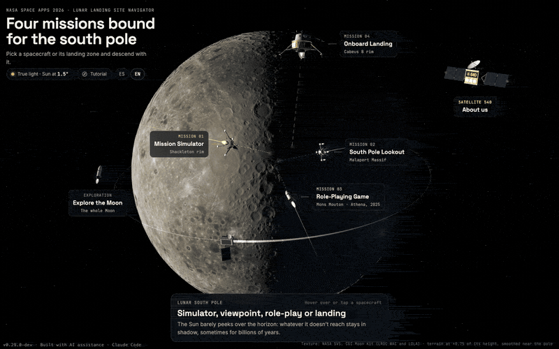

</details>

### Simulador de misiones

<!-- VIDEO: simulador, ~30 s. Planos sugeridos:
     1. (0-8 s) Planificar en cuatro pasos: elegir una nave de ejemplo, ver los requisitos, elegir un sitio del polo sur y marcar la ventana en el calendario coloreado por viabilidad.
     2. (8-15 s) El plan: arrastrar la barra de la misión por «¿Cuándo aterrizar?» y ver cómo cambian el veredicto, el Sol y las horas con Tierra.
     3. (15-19 s) «El cielo desde el sitio» en 3D: el Sol y la Tierra sobre el relieve LOLA.
     4. (19-25 s) Replanificar: un retraso de +3 d invalida el plan, ampliar el radio, aparece una salida y «Adoptar».
     5. (25-30 s) Avanzado: el top 3, el mapa del polo con las sombras y los ocho puntos de «Si aterrizas desviado». -->
https://github.com/user-attachments/assets/a982e374-893d-4930-a141-b92c609c5f20

El planificador, para quien prepara una misión al polo sur: dada una nave y sus requisitos (días en superficie, horas sin Sol que aguanta, % de Tierra a la vista), dice dónde y cuándo aterrizar, con el veredicto de cada día y su motivo. Tiene tres vistas: **Planificar** (cuatro pasos y el plan sobre una línea de tiempo), **Avanzado** (los mejores sitios, el mapa de sombras, qué pasa si aterrizas desviado y comparar escenarios) y **Replanificar** (qué hacer si el lanzamiento se retrasa). Con la API de datos usa efemérides reales y relieve LOLA; sin ella, un motor simulado, y la cabecera lo dice.

**[Abrir el simulador →](https://540.github.io/lunar-landing-site-navigator/web/)** · Detalle técnico en [`web/README.md`](web/README.md).

<details>
<summary>Capturas animadas de cada vista</summary>

#### Planificar: dónde y cuándo aterrizar

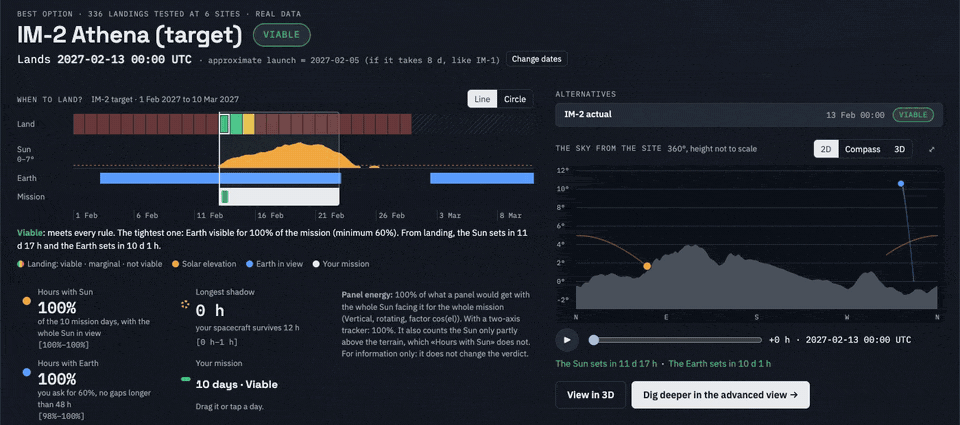

Arrastra la misión por la línea de tiempo: cada día lleva su veredicto, la altura del Sol sobre el relieve, las horas con la Tierra a la vista y cuánto falta para que se pongan el Sol y la Tierra.

<table>
<tr>
<td width="47%">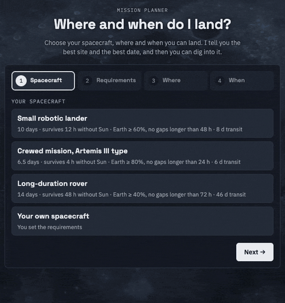</td>
<td width="53%">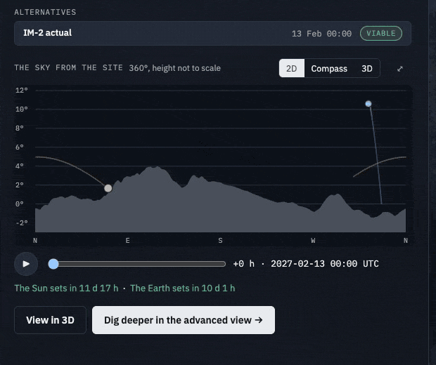</td>
</tr>
<tr>
<td><b>Cuatro pasos.</b> Nave, requisitos, dónde (polo sur, CLPS, Apollo, otros países o un punto propio) y cuándo, con cada día del calendario coloreado por viabilidad.</td>
<td><b>El cielo desde el sitio.</b> El Sol y la Tierra sobre el horizonte real, en 2D, brújula o 3D, hora a hora.</td>
</tr>
</table>

#### Replanificar cuando el lanzamiento se retrasa

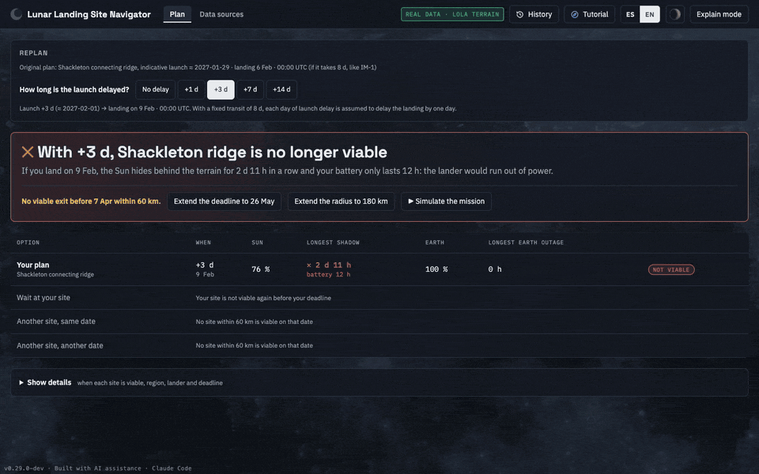

Con un retraso, el plan dice por qué deja de valer y busca la salida: esperar en el sitio, otro sitio el mismo día u otro sitio y otra fecha. «Adoptar» la convierte en el plan nuevo.

#### Investigar y comparar

<table>
<tr>
<td width="50%">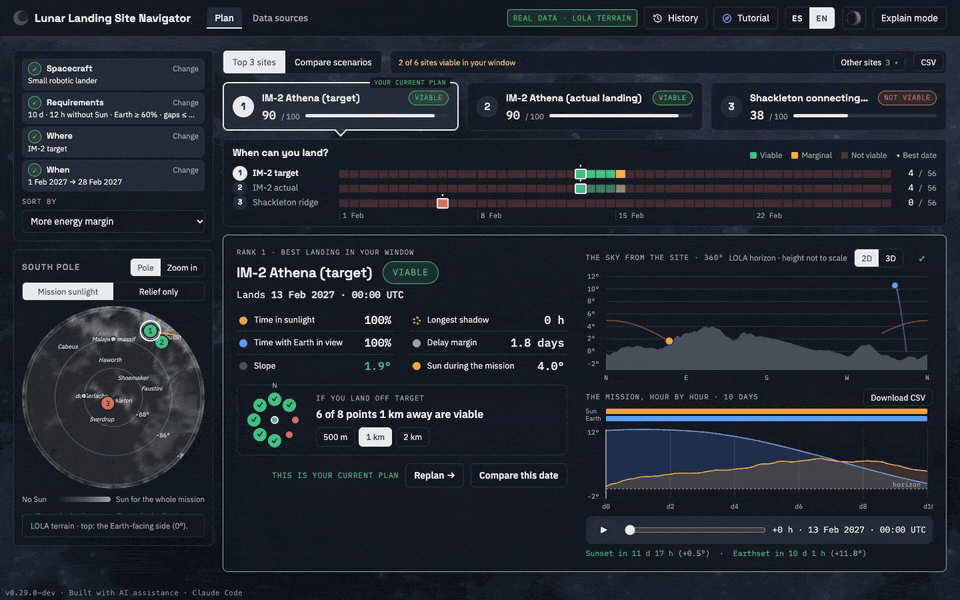</td>
<td width="50%">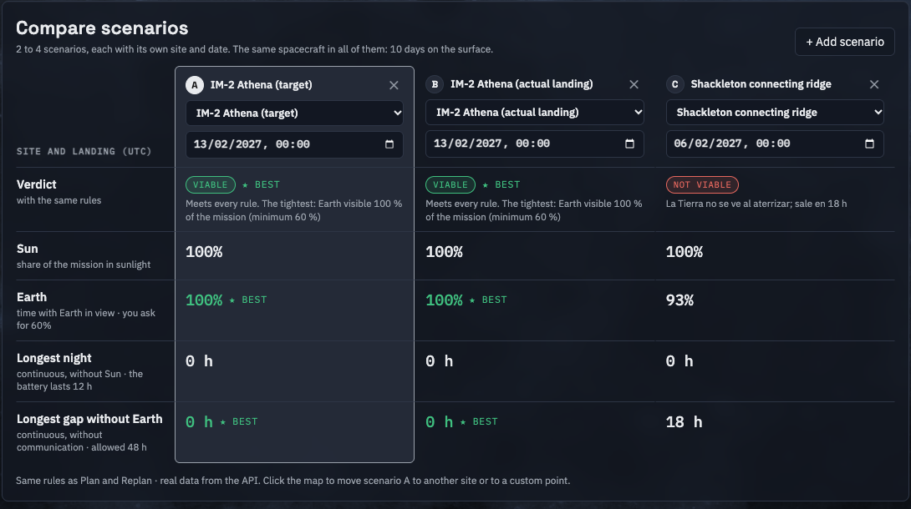</td>
</tr>
<tr>
<td><b>Vista avanzada.</b> Los mejores sitios, el mapa del polo con las sombras de la misión y qué pasa si aterrizas a 500 m, 1 km o 2 km del punto.</td>
<td><b>Comparar escenarios.</b> De 2 a 4 sitios y fechas, lado a lado, con las mismas reglas.</td>
</tr>
</table>

</details>

### Mirador del Polo Sur

<!-- VIDEO: mirador, ~30 s. Planos sugeridos:
     1. (0-10 s) Exploración: el relieve LOLA de una región del polo sur visto desde el dron; mover la línea de tiempo y ver cómo giran las sombras y se mueven el Sol y la Tierra.
     2. (10-20 s) Desde el simulador, «Ver en 3D»: el visor de misión reproduce el plan sobre el relieve con su veredicto.
     3. (20-30 s) Bajar a pie junto al lander (icono ⤢ del cielo o «a pie»): caminar con la gravedad lunar, mirar la brújula y el reloj; «Subir al dron» para volver. -->
https://github.com/user-attachments/assets/5bcc10c0-7aaa-4e93-bd6e-516068405d00

El polo sur en 3D, con el relieve LOLA y el Sol y la Tierra en su posición real: los días pasan en la línea de tiempo y las sombras giran. Sirve para entender a simple vista por qué la luz en el polo depende del relieve. Desde el simulador, «Ver en 3D» abre aquí el visor de misión, que reproduce el plan sobre el terreno con su veredicto y deja recorrerlo a pie.

**[Abrir el Mirador →](https://540.github.io/lunar-landing-site-navigator/viewpoint/)** · Detalle técnico en [`viewpoint/README.md`](viewpoint/README.md) y [`docs/arquitectura-tour.md`](docs/arquitectura-tour.md).

<details>
<summary>Captura animada</summary>

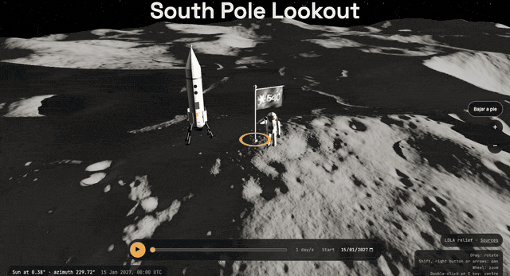

</details>

### Aterrizaje a bordo

<!-- VIDEO: aterrizaje, ~30 s. Planos sugeridos:
     1. (0-5 s) Tarjeta de inicio y «Empezar el descenso»: dentro de la cabina, con la tripulación sentada.
     2. (5-15 s) Frenado con la nave inclinada: el cielo por el parabrisas y el suelo por las ventanas laterales; mirar los paneles.
     3. (15-22 s) Tomar el mando (M) y ajustar empuje e inclinación; desplegar el tren (G).
     4. (22-30 s) Descenso final vertical, luz de contacto, motor parado y resumen del aterrizaje. -->
https://github.com/user-attachments/assets/612d720c-031b-4eae-bc6c-8c8d93efe725

Los últimos 4,6 km del descenso al borde de Cabeus B, vistos desde la cabina del módulo de aterrizaje. Para cualquiera que quiera sentir un alunizaje: el piloto automático sabe posarse solo, y se puede tomar el mando, caminar por la cabina y tocar los controles. La física usa la gravedad lunar y las cifras del motor de descenso del módulo lunar del Apolo; el Sol y la Tierra están donde los pone el motor del proyecto para ese sitio y fecha.

**[Abrir el aterrizaje →](https://540.github.io/lunar-landing-site-navigator/lander/)** · Detalle técnico, controles y qué es real en [`lander/README.md`](lander/README.md).

<details>
<summary>Captura animada</summary>

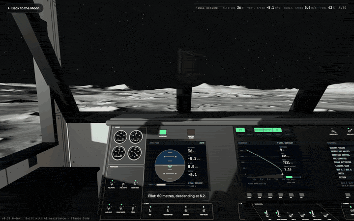

</details>

### Varados en el polo (en construcción)

Juego de rol educativo: llevar un rover por el mapa de Mons Mouton buscando la luz para cargar la batería y la Tierra para transmitir, antes de volver a la plataforma. Ya se puede jugar una misión mínima en [`/rolegame/`](https://540.github.io/lunar-landing-site-navigator/rolegame/); sigue en desarrollo. Detalle en [`rolegame/README.md`](rolegame/README.md) y [`docs/arquitectura-juego.md`](docs/arquitectura-juego.md).

<details>
<summary>Captura animada</summary>

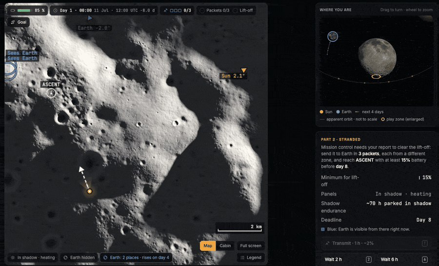

</details>

### API pública

Lo que calculan las pantallas está también en una API pública (REST v1 y GraphQL), para quien quiera usar los datos en su propia herramienta: dónde están el Sol y la Tierra vistos desde un sitio, si se ven tratando los dos como discos, ventanas de visibilidad (con `dsn=1`, también las horas con la Tierra visible y una antena de la Deep Space Network con la Luna a 10° o más), ranking de sitios, mejores aterrizajes y mapas de luz, con el relieve LOLA opcional (`terrain=1`). Contrato en [`data/openapi.yaml`](data/openapi.yaml), documentación interactiva en `/docs` y todas las rutas en [`data/README.md`](data/README.md).

Por ejemplo, el Sol y la Tierra vistos desde la cresta de conexión de Shackleton el 2027-01-15 a las 00:00 UTC, con relieve:

```sh
curl 'localhost:3100/v1/sun-earth?site=shackleton-rim&date=2027-01-15T00:00:00Z&terrain=1'
```

```json
{
  "site": {
    "id": "shackleton-rim",
    "name": "Cresta de conexión de Shackleton",
    "region": "Polo sur",
    "program": "Artemis (zona)",
    "latDeg": -89.44027,
    "lonDeg": -137.12649,
    "heightKm": 0,
    "coordinatesVerified": false,
    "custom": false,
    "horizonModel": "mask"
  },
  "date": "2027-01-15T00:00:00.000Z",
  "mode": "limb",
  "lookaheadDays": 45,
  "sun": {
    "azimuthDeg": 229.7233,
    "elevationDeg": 0.3834,
    "angularRadiusDeg": 0.271,
    "distanceKm": 147078011.7,
    "horizonElevationDeg": -1.5155,
    "visible": true,
    "visibleFraction": 1,
    "nextRise": null,
    "nextSet": null,
    "hoursToNextRise": null,
    "hoursToNextSet": null
  },
  "earth": {
    "azimuthDeg": 129.4618,
    "elevationDeg": 4.8044,
    "angularRadiusDeg": 0.9451,
    "distanceKm": 386678.9,
    "horizonElevationDeg": -2.1746,
    "visible": true,
    "visibleFraction": 1,
    "nextRise": "2027-02-05T15:44:45.498Z",
    "nextSet": "2027-01-24T11:15:31.201Z",
    "hoursToNextRise": 519.746,
    "hoursToNextSet": 227.259
  },
  "sunAndEarthVisible": true,
  "terrain": {
    "observerHeightM": 2,
    "applied": true,
    "source": "catalog",
    "demVersion": "lola-c33d4bb7a8cf",
    "note": "Máscara de horizonte precalculada del catálogo: LOLA LDEM_80S_20MPP_ADJ@20m + LDEM_80S_20MPP_ADJ@160m + LDEM_60S_240MPP_ADJ@240m (preciso, observador a 2 m)."
  }
}
```

El Sol está a 0,38° sobre el horizonte astronómico, pero el relieve en esa dirección baja a −1,52°, así que se ve entero; y en los 45 días que mira hacia delante (`lookaheadDays`) no se pone (`nextSet: null`). La Tierra se pone el 2027-01-24 y vuelve a salir el 2027-02-05. Respuesta de la API local con el DEM LOLA descargado (API 1.23.0); para arrancarla, ver [Backend y API](#backend-y-api-arrancar-y-probar).

Qué tal acierta: [`VALIDATION.md`](VALIDATION.md) compara cada endpoint con fuentes oficiales (JPL Horizons, PGDA/LOLA, Gläser et al. 2018, Leone et al. 2023, NSSDC/LROC y misiones reales).

---

## Para desarrolladores

### Arrancar

```sh
npm start        # todo el sitio en http://localhost:4540, empezando por la portada
npm test         # typecheck de backend/ y data/, y tests de backend/ (con los dorados), data/ y planner/ (antes: `npm ci --prefix backend && npm ci --prefix data`)
```

No hay que instalar nada para ver el sitio: es HTML y JavaScript sin build. En la portada, la misión **Simulador de misiones** baja hasta el polo sur y, con «Adelante», abre el planificador; el nombre del producto en la barra del planificador vuelve a la Luna.

El sitio está en castellano e inglés: `?lang=es` (o `en`) en la dirección, el conmutador ES / EN de cada pantalla o el idioma del navegador.

### Qué hay

```
home/        Portada: la Luna en 3D, cuatro misiones y «Explorar la Luna» /home/
web/         Simulador de misiones: la interfaz del planificador    /web/
rolegame/    Juego de rol «Varados en el polo» (en construcción)    /rolegame/
lander/      Aterrizaje a bordo: el descenso visto desde la cabina  /lander/
viewpoint/   Mirador del Polo Sur: exploración 3D y visor de misión /viewpoint/
data/        API pública v1 de efemérides
planner/     Evaluador de viabilidad de aterrizajes
shared/      Código común de las pantallas (calidad del render)     /shared/
release/     Herramienta de release
automerge/   Fusión automática de las PR de la software-factory
tools/       Banco de medición del render de la portada (render-bench/) y versión del sitio (version/)
serve.mjs    Servidor del sitio: las URL son las carpetas
```

| Carpeta | Qué es | Arrancar |
|---|---|---|
| [`home/`](home/) | Portada 3D del polo sur con las cuatro misiones (simulador, Mirador, juego de rol y aterrizaje a bordo). Las cuatro tienen pantalla. Con «Explorar la Luna», zonas de toda la Luna con una tarjeta para público general; sus cifras de luz y Tierra salen del motor (`home/scripts/build-zones.ts` → `home/data/zones.json`) | `npm start` → <http://localhost:4540> |
| [`rolegame/`](rolegame/) | Juego de rol «Varados en el polo»: misión mínima jugable sobre un escenario generado por el pipeline ([`docs/arquitectura-juego.md`](docs/arquitectura-juego.md)) | `npm start` → <http://localhost:4540/rolegame/> |
| [`lander/`](lander/) | Aterrizaje a bordo: simulador del descenso al polo sur en primera persona, dentro de la cabina, con física de descenso, piloto automático y mando manual | `npm start` → <http://localhost:4540/lander/> |
| [`web/`](web/) | Interfaz del planificador partida por vistas (Planificar, Avanzado, Replanificar), con la API de datos o, sin ella, datos de ejemplo | `node web/serve.mjs` → <http://localhost:4542> |
| [`viewpoint/`](viewpoint/) | Mirador del Polo Sur: exploración 3D del polo sur con relieve LOLA y, desde «Ver en 3D», visor de misión del simulador ([`docs/arquitectura-tour.md`](docs/arquitectura-tour.md)) | `npm start` → <http://localhost:4540/viewpoint/> |
| [`backend/`](backend/README.md) | Motor de cálculo (efemérides Sol/Tierra, visibilidad de discos, ventanas, búsqueda de sitios y relieve LOLA) con un caso de uso por operación (`src/useCases.ts`) y [evals](backend/evals/README.md). Sin servidor propio: la API es la de `data/` | `cd backend && npm ci && npm test` |
| [`data/`](data/) | API pública v1 de efemérides (Sol y Tierra por sitio y fecha), con relieve opcional (`terrain=1`). Usa el motor de `backend/src/`, sin copia | `npm ci --prefix backend && cd data && npm ci && npm start` → puerto 3100 |
| [`planner/`](planner/) | Evaluador de viabilidad de aterrizajes sobre la API | `cd planner && npm run evaluate -- --site … --date …` |
| [`tools/render-bench/`](tools/render-bench/README.md) | Banco de medición del render de la portada en Chrome sin interfaz: tiempo de frame, memoria de GPU y capturas comparables, con los valores de calidad que se le den. No entra en `npm test` | `npm run bench:render -- --zone simulador` |
| [`tools/version/`](tools/version/README.md) | Versión semántica del sitio: el workflow de Pages la decide antes de cada deploy (etiqueta `vX.Y.Z`) y las pantallas la muestran abajo a la izquierda | `node tools/version/next.mjs` |
| [`shared/`](shared/README.md) | Código común que importan las pantallas: los niveles de calidad del render 3D (`alto`, `medio` y `bajo`, `?q=…`). No es una pantalla. Sus tests, en `tests/quality.test.mjs` | con el sitio: `npm start` |

Lo que se ve en el navegador (`home/`, `web/`, `viewpoint/`, `rolegame/`, `lander/`) lo sirve un único servidor, [`serve.mjs`](serve.mjs), con las mismas rutas que las carpetas: por eso los enlaces entre ellas son relativos (`../web/`, `../home/`) y valen igual en cualquier alojamiento estático. Una pantalla nueva es una carpeta nueva al lado, añadida a `MOUNTS` en `serve.mjs` y a `cp -R` en `.github/workflows/pages.yml`, y enlazada desde su misión en `home/index.html` (campo `href` de `ZONES`). Dentro sigue la forma de `planner/`: `index.html`, código en `src/`, tests en `tests/` y su `package.json` con `npm test`, que se añade al `npm test` de la raíz (como `viewpoint/`, `rolegame/` y `lander/`).

### Cómo llega el trabajo aquí

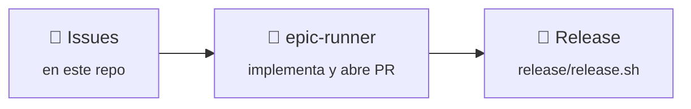

### Stack

Sitio estático sin build (HTML, CSS y módulos de JavaScript; las cinco pantallas cargan three.js desde CDN) y Node para `data/`, `planner/` y el servidor. Los comandos de arranque y test están arriba y en `CLAUDE.md`: la release los usa para verificar antes de publicar.

`backend/` y `data/`: Node 26.13 (`.nvmrc` en `backend/`), ES modules y TypeScript sin build (Node quita los tipos al ejecutar; `npm run typecheck` los comprueba con `tsc`); tests con `node:test`. Dependencias con versión exacta: `astronomy-engine` (efemérides, en `backend/`), `graphql` y `yaml` (en `data/`).

### Backend y API: arrancar y probar

```sh
cd backend && npm ci && npm test   # primero el motor: data/ resuelve sus dependencias desde backend/node_modules
node evals/golden.ts check         # resultados dorados de los evals (desde backend/, no escribe nada)
cd ../data && npm ci && npm test   # API pública v1: contrato, ejemplos reales y relieve opcional
```

Qué tal acierta: [`VALIDATION.md`](VALIDATION.md) es la matriz de validación de cada endpoint frente a fuentes oficiales
(JPL Horizons, PGDA/LOLA, Gläser et al. 2018, Leone et al. 2023, NSSDC/LROC y misiones reales), generada con
`npm run validate -- --write` (necesita el DEM, ver «Relieve»); [`data/ACCURACY.md`](data/ACCURACY.md), el detalle de
efemérides frente a JPL Horizons. Para explorarla punto a punto, `npm run validate:view`: la misma medición en una página
HTML (fuera de git) con la dispersión, el histograma de errores, los peores puntos y el mapa polar de cada fila
(`-- --cached` la rehace con la última medición, sin medir; `-- --no-open` no la abre; detalle en `backend/README.md`).

```sh
cd data && npm start               # API pública v1 y GraphQL en http://localhost:3100 (documentación en /docs); backend/ no tiene servidor propio
```

### Relieve (opcional)

En el polo sur el relieve manda en la luz y en la visibilidad de la Tierra. El horizonte real sale de los DEM LOLA de
PGDA/GSFC. Las máscaras precalculadas de los sitios del catálogo están en git (`backend/terrain/masks/`, ~48 KB); el DEM
no (`backend/terrain/cache/`, unos 400 MB, en `.gitignore`). Para calcular horizontes de cualquier punto:

```sh
cd backend
node scripts/fetch-dem.ts     # descarga única del DEM a terrain/cache/
node scripts/build-masks.ts   # precalcula las máscaras del catálogo (terrain/masks/)
```

Sin DEM todo funciona: los tests no lo necesitan y, donde no hay máscara, el horizonte es el de una Luna esférica (0°).
En la API pública el relieve se pide con `terrain=1`; sin él las respuestas de v1 no cambian. Detalle en
[`backend/README.md`](backend/README.md#relieve-máscaras-de-horizonte-lola) y [`data/README.md`](data/README.md).

### Despliegue de la API

La API de datos (`data/`, con el motor de `backend/`) está desplegada en <https://540lunarapi.dev>, con el relieve LOLA
completo y las mismas respuestas que en local.

La web de GitHub Pages usa esa API: su URL está en la variable del repo `LUNAR_API_URL`
(`gh variable set LUNAR_API_URL --body https://…`) y el despliegue de Pages la escribe en `planner/src/config.js`. Sin la
variable, y en local, la URL es `http://localhost:3100`. En cualquier pantalla, `?api=https://…` la cambia a mano.

### Release

```sh
./release/release.sh              # prepara: versión, verificación y notas, sin tocar nada
./release/release.sh --publicar   # CHANGELOG, etiqueta, push y release de GitHub
```

Detalle y release automática tras cada commit en [`release/README.md`](release/README.md).

## Uso de inteligencia artificial

Este proyecto se ha desarrollado con ayuda de IA. [Claude Code](https://claude.com/claude-code), de Anthropic, ha escrito código, tests y documentación a partir de historias que el equipo de 540 define, revisa y prueba; los commits en los que ha participado llevan su `Co-Authored-By`. El sitio lo dice en cada pantalla, abajo a la izquierda junto a la versión («Hecho con ayuda de IA · Claude Code»), y en la ficha «Quiénes somos» de la portada.

También están generados con IA:

- **El vídeo general de este README**: con Claude Code (Artifacts) a partir de la propia aplicación, con locución de [Kokoro TTS](https://huggingface.co/hexgrad/Kokoro-82M).
- **El arte del logo de 540 de la bandera del Mirador** (`viewpoint/assets/flag-540.jpg`): con Google Gemini.
- **El icono de la web** (`web/assets/icon-512.png` y sus tamaños menores).

Las imágenes llevan una marca de agua visible («AI-generated»), salvo el icono de 32 px, demasiado pequeño para que se lea.

## Licencia

El código del equipo 540 se publica con la licencia MIT: ver [`LICENSE`](LICENSE). Cubre solo ese código; los datos y las librerías de terceros (las efemérides de astronomy-engine, el relieve LOLA de NASA/PGDA, three.js y el resto) conservan sus propias licencias y créditos, que se citan uno a uno, con su organismo, su cita y su licencia o condiciones de uso, en la pestaña «Fuentes de datos» del planificador (`web/`). Horizons es solo la referencia contra la que se valida: [`VALIDATION.md`](VALIDATION.md) detalla esas comprobaciones. El Mirador tiene su propio diálogo «Fuentes» y la portada, el crédito de sus texturas, con los mismos nombres de recurso que la pestaña.

---

Este README es la versión en español del [`README.md`](README.md), que está en inglés para el jurado de Space Apps: quien cambie uno, cambia el otro.
