<div align="center">

# Lunar Landing Site Navigator

**Compare lunar landing sites and dates in seconds, with the Sun and the Earth against the real horizon.**

[](https://www.spaceappschallenge.org/2026/challenges/lunar-landing-site-navigator/)
[](#)

**English** · [Español](README.es.md)

</div>

---

https://github.com/user-attachments/assets/4ca7545a-1223-4f19-85bb-b2a1f82ee96a

<sub>Video generated with AI (Claude Code Artifacts) from our application; voice-over generated with AI (Kokoro TTS).</sub>

<div align="center">

**[Open the site →](https://540.github.io/lunar-landing-site-navigator/home/?lang=en)**

</div>

At the Moon's south pole the Sun stays low on the horizon, and the terrain decides whether a site gets light for its solar panels and keeps the Earth in view to communicate. This tool computes both with real ephemerides and LOLA terrain, tells you whether a mission is viable at a given site and date, and shows it on screens built for mission planners and for the general public.

## Contents

- [Features](#features)
  - [Home page and «Explore the Moon»](#home-page-and-explore-the-moon)
  - [Mission Simulator](#mission-simulator)
  - [South Pole Lookout](#south-pole-lookout)
  - [Onboard Landing](#onboard-landing)
  - [Stranded at the Pole (under construction)](#stranded-at-the-pole-under-construction)
  - [Public API](#public-api)
- [For developers](#for-developers)
- [Use of artificial intelligence](#use-of-artificial-intelligence)
- [License](#license)

## Features

The site is in English and Spanish (`?lang=en` or the ES / EN switch on each screen). The animated captures in each section were recorded on the site with the real data API (ephemerides and LOLA terrain).

### Home page and «Explore the Moon»

https://github.com/user-attachments/assets/b8ee106a-7fea-490b-850c-cdf2a5b5eb76

The entry to the site: the Moon in 3D seen from the south pole, with four missions, each leading to its own screen. In «Explore the Moon», zones across the whole Moon (Shackleton, Cabeus, Von Kármán, Apollo 11 and 15, Blue Ghost 1 and the north pole), each with a card for a non-technical audience that explains whether you can land there and why; its light, Earth and slope figures come from the computation engine.

**[Open the home page →](https://540.github.io/lunar-landing-site-navigator/home/?lang=en)** · Technical details in [`home/README.md`](home/README.md).

<details>
<summary>Animated capture</summary>

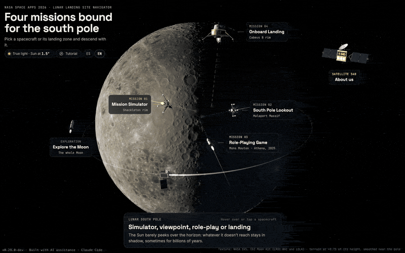

</details>

### Mission Simulator

https://github.com/user-attachments/assets/a982e374-893d-4930-a141-b92c609c5f20

The planner, for whoever prepares a mission to the south pole: given a spacecraft and its requirements (days on the surface, hours without Sun it can survive, % of time with the Earth in view), it says where and when to land, with each day's verdict and its reason. It has three views: **Plan** (four steps and the plan on a timeline), **Advanced** (the best sites, the shadow map, what happens if you land off target, and scenario comparison) and **Replan** (what to do if the launch slips). With the data API it uses real ephemerides and LOLA terrain; without it, a simulated engine, and the header says so.

**[Open the simulator →](https://540.github.io/lunar-landing-site-navigator/web/?lang=en)** · Technical details in [`web/README.md`](web/README.md).

<details>
<summary>Animated captures of each view</summary>

#### Plan: where and when to land

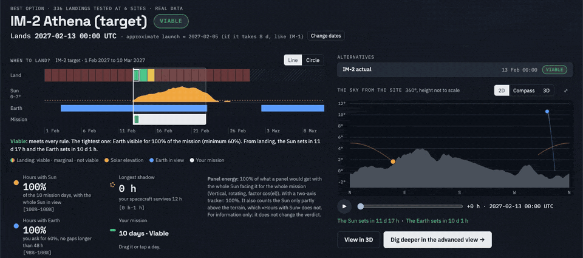

Drag the mission along the timeline: each day carries its verdict, the Sun's elevation above the terrain, the hours with the Earth in view and how long until the Sun and the Earth set.

<table>
<tr>
<td width="47%">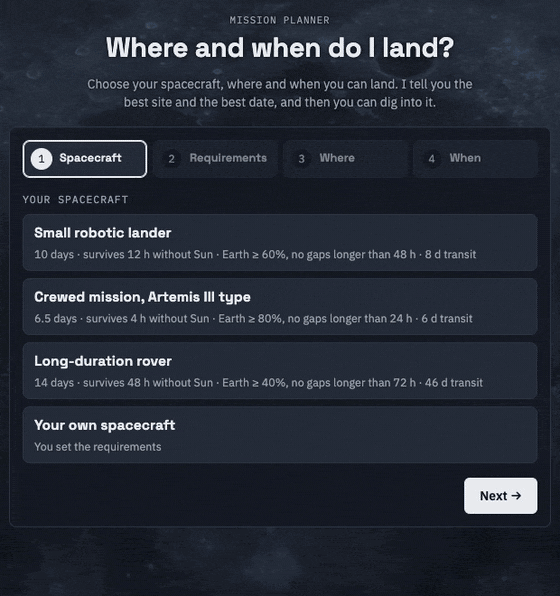</td>
<td width="53%">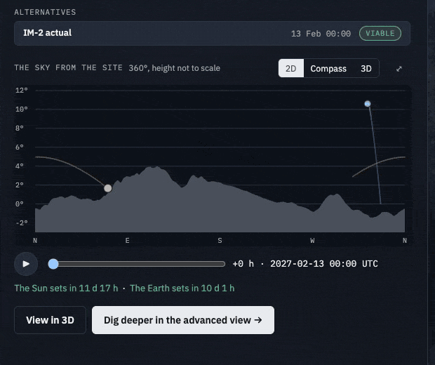</td>
</tr>
<tr>
<td><b>Four steps.</b> Spacecraft, requirements, where (south pole, CLPS, Apollo, other countries or a custom point) and when, with each calendar day coloured by viability.</td>
<td><b>The sky from the site.</b> The Sun and the Earth over the real horizon, in 2D, compass or 3D, hour by hour.</td>
</tr>
</table>

#### Replan when the launch slips

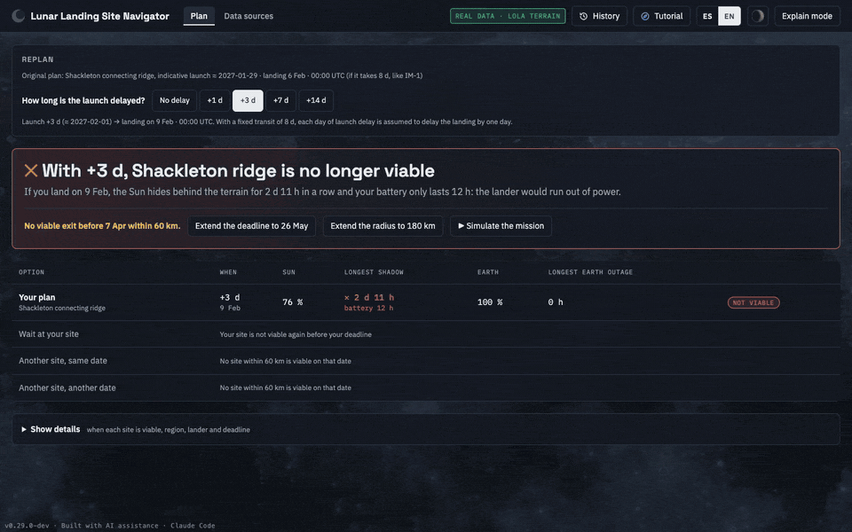

With a delay, the plan says why it no longer works and looks for a way out: wait at the site, another site on the same day, or another site and another date. «Adopt» turns it into the new plan.

#### Investigate and compare

<table>
<tr>
<td width="50%">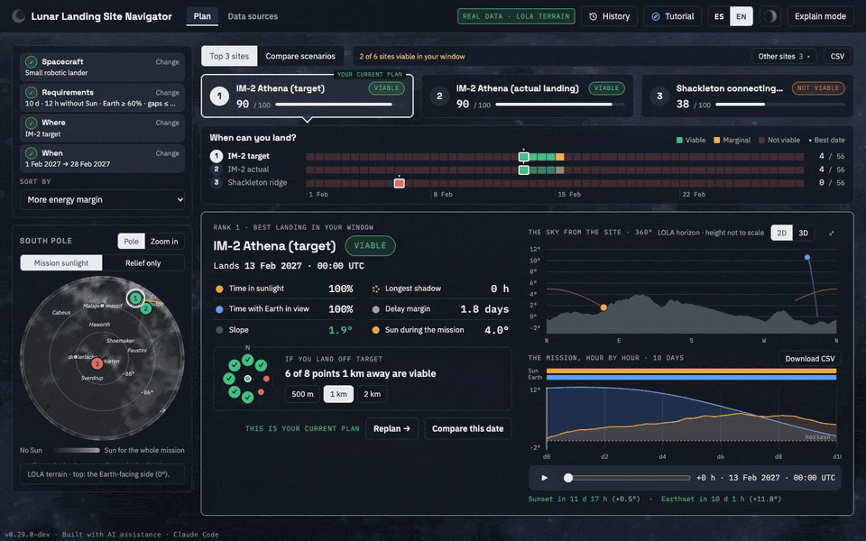</td>
<td width="50%">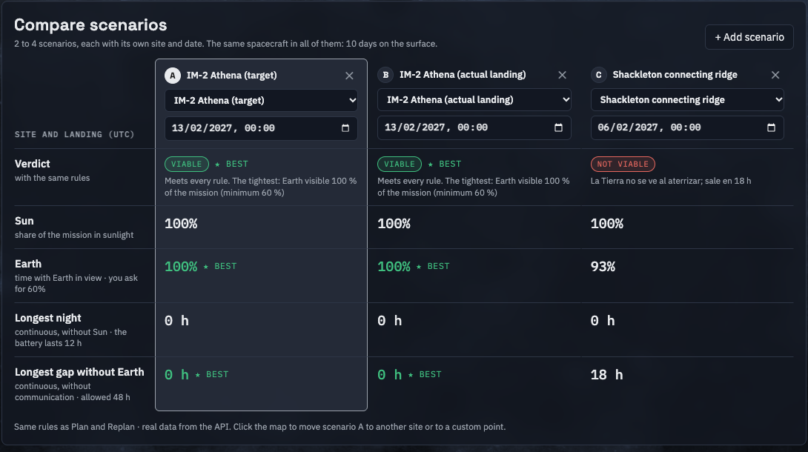</td>
</tr>
<tr>
<td><b>Advanced view.</b> The best sites, the south pole map with the mission's shadows, and what happens if you land 500 m, 1 km or 2 km off target.</td>
<td><b>Compare scenarios.</b> 2 to 4 sites and dates, side by side, with the same rules.</td>
</tr>
</table>

</details>

### South Pole Lookout

https://github.com/user-attachments/assets/5bcc10c0-7aaa-4e93-bd6e-516068405d00

The south pole in 3D, with LOLA terrain and the Sun and the Earth where they really are: the days go by on the timeline and the shadows turn. It shows at a glance why light at the pole depends on the terrain. From the simulator, «View in 3D» opens the mission viewer here, which replays the plan over the terrain with its verdict and lets you walk around it.

**[Open the Lookout →](https://540.github.io/lunar-landing-site-navigator/viewpoint/?lang=en)** · Technical details in [`viewpoint/README.md`](viewpoint/README.md) and [`docs/arquitectura-tour.md`](docs/arquitectura-tour.md).

<details>
<summary>Animated capture</summary>

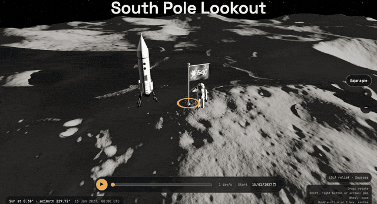

</details>

### Onboard Landing

https://github.com/user-attachments/assets/612d720c-031b-4eae-bc6c-8c8d93efe725

The last 4.6 km of the descent to the rim of Cabeus B, seen from inside the lander's cockpit. For anyone who wants to feel a Moon landing: the autopilot can touch down on its own, and you can take control, walk around the cockpit and use the controls. The physics uses lunar gravity and the figures of the Apollo lunar module's descent engine; the Sun and the Earth are where the project's engine puts them for that site and date.

**[Open the landing →](https://540.github.io/lunar-landing-site-navigator/lander/?lang=en)** · Technical details, controls and what is real in [`lander/README.md`](lander/README.md).

<details>
<summary>Animated capture</summary>

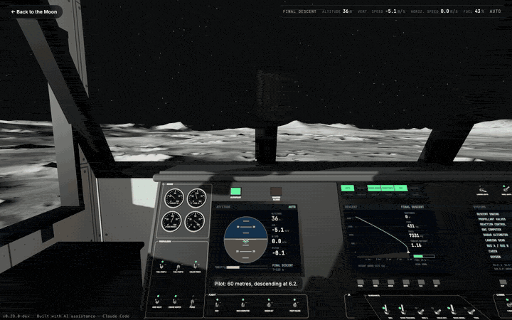

</details>

### Stranded at the Pole (under construction)

Educational role-playing game: drive a rover across the Mons Mouton map, seeking light to charge the battery and the Earth to transmit, before heading back to the launch pad. A minimal mission is already playable at [`/rolegame/`](https://540.github.io/lunar-landing-site-navigator/rolegame/?lang=en); it is still in development. Details in [`rolegame/README.md`](rolegame/README.md) and [`docs/arquitectura-juego.md`](docs/arquitectura-juego.md).

<details>
<summary>Animated capture</summary>

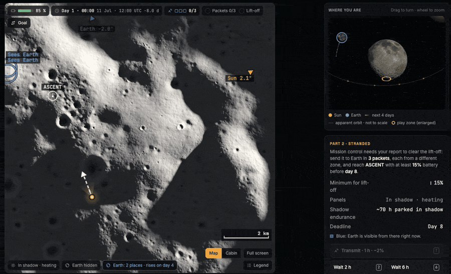

</details>

### Public API

What the screens compute is also available through a public API (REST v1 and GraphQL), for anyone who wants to use the data in their own tool: where the Sun and the Earth are as seen from a site, whether they are visible (treating both as discs), visibility windows (with `dsn=1`, also the hours with the Earth visible and a Deep Space Network antenna with the Moon at 10° or more), site ranking, best landings and light maps, with optional LOLA terrain (`terrain=1`). Contract in [`data/openapi.yaml`](data/openapi.yaml), interactive documentation at `/docs`, and every route in [`data/README.md`](data/README.md).

For example, the Sun and the Earth as seen from the Shackleton connecting ridge on 2027-01-15 at 00:00 UTC, with terrain:

```sh
curl 'localhost:3100/v1/sun-earth?site=shackleton-rim&date=2027-01-15T00:00:00Z&terrain=1'
```

```json
{
  "site": {
    "id": "shackleton-rim",
    "name": "Cresta de conexión de Shackleton",
    "region": "Polo sur",
    "program": "Artemis (zona)",
    "latDeg": -89.44027,
    "lonDeg": -137.12649,
    "heightKm": 0,
    "coordinatesVerified": false,
    "custom": false,
    "horizonModel": "mask"
  },
  "date": "2027-01-15T00:00:00.000Z",
  "mode": "limb",
  "lookaheadDays": 45,
  "sun": {
    "azimuthDeg": 229.7233,
    "elevationDeg": 0.3834,
    "angularRadiusDeg": 0.271,
    "distanceKm": 147078011.7,
    "horizonElevationDeg": -1.5155,
    "visible": true,
    "visibleFraction": 1,
    "nextRise": null,
    "nextSet": null,
    "hoursToNextRise": null,
    "hoursToNextSet": null
  },
  "earth": {
    "azimuthDeg": 129.4618,
    "elevationDeg": 4.8044,
    "angularRadiusDeg": 0.9451,
    "distanceKm": 386678.9,
    "horizonElevationDeg": -2.1746,
    "visible": true,
    "visibleFraction": 1,
    "nextRise": "2027-02-05T15:44:45.498Z",
    "nextSet": "2027-01-24T11:15:31.201Z",
    "hoursToNextRise": 519.746,
    "hoursToNextSet": 227.259
  },
  "sunAndEarthVisible": true,
  "terrain": {
    "observerHeightM": 2,
    "applied": true,
    "source": "catalog",
    "demVersion": "lola-c33d4bb7a8cf",
    "note": "Máscara de horizonte precalculada del catálogo: LOLA LDEM_80S_20MPP_ADJ@20m + LDEM_80S_20MPP_ADJ@160m + LDEM_60S_240MPP_ADJ@240m (preciso, observador a 2 m)."
  }
}
```

The Sun is 0.38° above the astronomical horizon, but the terrain in that direction drops to −1.52°, so the whole disc is visible; and within the 45 days the API looks ahead (`lookaheadDays`) it does not set (`nextSet: null`). The Earth sets on 2027-01-24 and rises again on 2027-02-05. Site names and notes come back in Spanish. Response from the local API with the LOLA DEM downloaded (API 1.23.0); to start it, see [Backend and API](#backend-and-api-start-and-test).

How accurate it is: [`VALIDATION.md`](VALIDATION.md) compares each endpoint with official sources (JPL Horizons, PGDA/LOLA, Gläser et al. 2018, Leone et al. 2023, NSSDC/LROC and real missions).

---

## For developers

### Getting started

```sh
npm start        # the whole site at http://localhost:4540, starting at the home page
npm test         # typecheck of backend/ and data/, and tests of backend/ (with the golden results), data/ and planner/ (first: `npm ci --prefix backend && npm ci --prefix data`)
```

Nothing needs installing to see the site: it is HTML and JavaScript with no build step. On the home page, the **Mission Simulator** mission descends to the south pole and, with «Proceed», opens the planner; the product name in the planner's bar goes back to the Moon.

The site is in English and Spanish: `?lang=en` (or `es`) in the address, the ES / EN switch in each screen, or the browser's language.

### What's inside

```
home/        Home page: the Moon in 3D, four missions and «Explore the Moon»  /home/
web/         Mission Simulator: the planner interface                         /web/
rolegame/    Role-playing game «Stranded at the Pole» (under construction)   /rolegame/
lander/      Onboard Landing: the descent seen from the cockpit               /lander/
viewpoint/   South Pole Lookout: 3D exploration and mission viewer            /viewpoint/
data/        Public ephemeris API v1
planner/     Landing feasibility evaluator
shared/      Code shared by the screens (render quality)                      /shared/
release/     Release tool
automerge/   Automatic merge of the software-factory PRs
tools/       Render bench for the home page (render-bench/) and site version (version/)
serve.mjs    Site server: the URLs are the folders
```

| Folder | What it is | Start |
|---|---|---|
| [`home/`](home/) | 3D home page of the south pole with the four missions (simulator, Lookout, role-playing game and onboard landing). All four have a screen. With «Explore the Moon», zones across the whole Moon with a card for the general public; their light and Earth figures come from the engine (`home/scripts/build-zones.ts` → `home/data/zones.json`) | `npm start` → <http://localhost:4540> |
| [`rolegame/`](rolegame/) | Role-playing game «Stranded at the Pole»: a minimal playable mission on a scenario generated by the pipeline ([`docs/arquitectura-juego.md`](docs/arquitectura-juego.md)) | `npm start` → <http://localhost:4540/rolegame/> |
| [`lander/`](lander/) | Onboard Landing: first-person simulator of the descent to the south pole, inside the cockpit, with descent physics, autopilot and manual control | `npm start` → <http://localhost:4540/lander/> |
| [`web/`](web/) | Planner interface split into views (Plan, Advanced, Replan), with the data API or, without it, example data | `node web/serve.mjs` → <http://localhost:4542> |
| [`viewpoint/`](viewpoint/) | South Pole Lookout: 3D exploration of the south pole with LOLA terrain and, from «View in 3D», the simulator's mission viewer ([`docs/arquitectura-tour.md`](docs/arquitectura-tour.md)) | `npm start` → <http://localhost:4540/viewpoint/> |
| [`backend/`](backend/README.md) | Computation engine (Sun/Earth ephemerides, disc visibility, windows, site search and LOLA terrain) with one use case per operation (`src/useCases.ts`) and [evals](backend/evals/README.md). No server of its own: the API is the one in `data/` | `cd backend && npm ci && npm test` |
| [`data/`](data/) | Public ephemeris API v1 (Sun and Earth by site and date), with optional terrain (`terrain=1`). Uses the engine in `backend/src/`, without a copy | `npm ci --prefix backend && cd data && npm ci && npm start` → port 3100 |
| [`planner/`](planner/) | Landing feasibility evaluator on top of the API | `cd planner && npm run evaluate -- --site … --date …` |
| [`tools/render-bench/`](tools/render-bench/README.md) | Render bench for the home page in headless Chrome: frame time, GPU memory and comparable screenshots, with the quality values given. Not part of `npm test` | `npm run bench:render -- --zone simulador` |
| [`tools/version/`](tools/version/README.md) | Semantic version of the site: the Pages workflow decides it before each deploy (tag `vX.Y.Z`) and the screens show it at the bottom left | `node tools/version/next.mjs` |
| [`shared/`](shared/README.md) | Common code the screens import: the 3D render quality levels (`alto`, `medio` and `bajo`, `?q=…`). Not a screen. Its tests, in `tests/quality.test.mjs` | with the site: `npm start` |

What runs in the browser (`home/`, `web/`, `viewpoint/`, `rolegame/`, `lander/`) is served by a single server, [`serve.mjs`](serve.mjs), with the same paths as the folders: that is why the links between them are relative (`../web/`, `../home/`) and work the same on any static host. A new screen is a new folder alongside, added to `MOUNTS` in `serve.mjs` and to `cp -R` in `.github/workflows/pages.yml`, and linked from its mission in `home/index.html` (`href` field of `ZONES`). Inside it follows the shape of `planner/`: `index.html`, code in `src/`, tests in `tests/` and its `package.json` with `npm test`, added to the root `npm test` (like `viewpoint/`, `rolegame/` and `lander/`).

### How work gets here

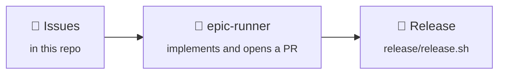

### Stack

Static site with no build step (HTML, CSS and JavaScript modules; all five screens load three.js from a CDN) and Node for `data/`, `planner/` and the server. The start and test commands are above and in `CLAUDE.md`: the release uses them to verify before publishing.

`backend/` and `data/`: Node 26.13 (`.nvmrc` in `backend/`), ES modules and TypeScript with no build (Node strips the types when running; `npm run typecheck` checks them with `tsc`); tests with `node:test`. Dependencies pinned to exact versions: `astronomy-engine` (ephemerides, in `backend/`), `graphql` and `yaml` (in `data/`).

### Backend and API: start and test

```sh
cd backend && npm ci && npm test   # the engine first: data/ resolves its dependencies from backend/node_modules
node evals/golden.ts check         # golden results of the evals (from backend/, writes nothing)
cd ../data && npm ci && npm test   # public API v1: contract, real examples and optional terrain
```

How accurate it is: [`VALIDATION.md`](VALIDATION.md) is the validation matrix of each endpoint against official sources
(JPL Horizons, PGDA/LOLA, Gläser et al. 2018, Leone et al. 2023, NSSDC/LROC and real missions), generated with
`npm run validate -- --write` (needs the DEM, see «Terrain»); [`data/ACCURACY.md`](data/ACCURACY.md), the detail of the
ephemerides against JPL Horizons. To explore it point by point, `npm run validate:view`: the same measurement in an HTML
page (outside git) with the scatter plot, the error histogram, the worst points and the polar map of each row
(`-- --cached` rebuilds it from the last measurement, without measuring; `-- --no-open` does not open it; details in `backend/README.md`).

```sh
cd data && npm start               # public API v1 and GraphQL at http://localhost:3100 (documentation at /docs); backend/ has no server of its own
```

### Terrain (optional)

At the south pole the terrain rules the light and the visibility of the Earth. The real horizon comes from the LOLA DEMs
of PGDA/GSFC. The precomputed masks of the catalogue sites are in git (`backend/terrain/masks/`, ~48 KB); the DEM is
not (`backend/terrain/cache/`, about 400 MB, in `.gitignore`). To compute horizons for any point:

```sh
cd backend
node scripts/fetch-dem.ts     # one-off download of the DEM to terrain/cache/
node scripts/build-masks.ts   # precomputes the catalogue masks (terrain/masks/)
```

Everything works without the DEM: the tests do not need it and, where there is no mask, the horizon is that of a spherical Moon (0°).
In the public API, terrain is requested with `terrain=1`; without it, v1 responses do not change. Details in
[`backend/README.md`](backend/README.md#relieve-máscaras-de-horizonte-lola) and [`data/README.md`](data/README.md).

### API deployment

The data API (`data/`, with the engine from `backend/`) is deployed at <https://540lunarapi.dev>, with the full LOLA
terrain and the same responses as locally.

The GitHub Pages site uses that API: its URL is in the repo variable `LUNAR_API_URL`
(`gh variable set LUNAR_API_URL --body https://…`) and the Pages deploy writes it into `planner/src/config.js`. Without
the variable, and locally, the URL is `http://localhost:3100`. In any screen, `?api=https://…` changes it by hand.

### Release

```sh
./release/release.sh              # prepares: version, verification and notes, without touching anything
./release/release.sh --publicar   # CHANGELOG, tag, push and GitHub release
```

Details and the automatic release after each commit in [`release/README.md`](release/README.md).

## Use of artificial intelligence

This project was developed with AI assistance. [Claude Code](https://claude.com/claude-code), by Anthropic, has written code, tests and documentation from stories that the 540 team defines, reviews and tests; the commits it took part in carry its `Co-Authored-By`. The site says so on every screen, at the bottom left next to the version («Built with AI assistance · Claude Code»), and in the «About us» card on the home page.

Also generated with AI:

- **The main video of this README**: with Claude Code (Artifacts) from the application itself, with a voice-over by [Kokoro TTS](https://huggingface.co/hexgrad/Kokoro-82M).
- **The 540 logo artwork on the Lookout flag** (`viewpoint/assets/flag-540.jpg`): with Google Gemini.
- **The site icon** (`web/assets/icon-512.png` and its smaller sizes).

The images carry a visible watermark («AI-generated»), except the 32 px icon, too small for it to be readable.

## License

The 540 team's code is released under the MIT license: see [`LICENSE`](LICENSE). It covers only that code; third-party data and libraries (the astronomy-engine ephemerides, NASA/PGDA LOLA terrain, three.js and the rest) keep their own licenses and credits, which are cited one by one, with their organisation, citation and license or terms of use, in the «Data sources» tab of the planner (`web/`). Horizons is only the reference the calculation is validated against: [`VALIDATION.md`](VALIDATION.md) details those checks. The Viewpoint has its own «Sources» dialog and the home page credits its textures, with the same resource names as the tab.
